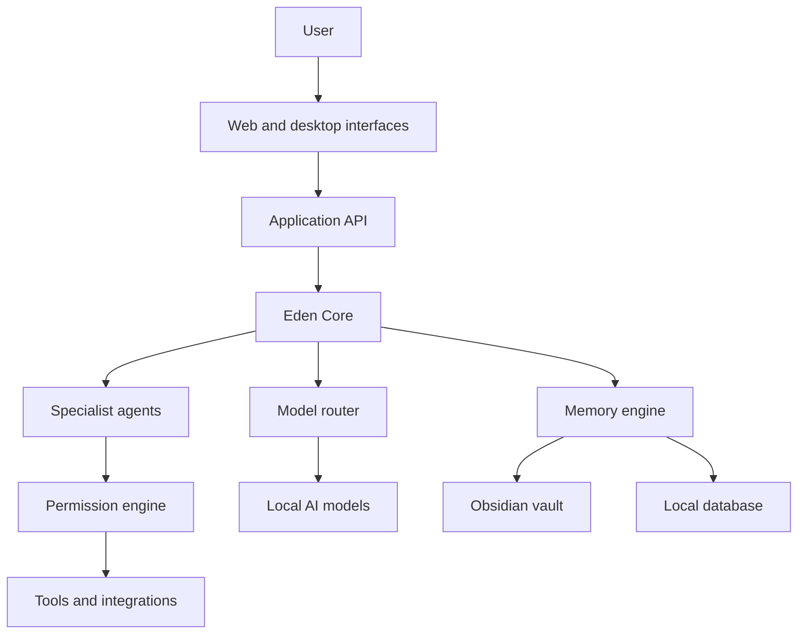

 

  

  
  
  

## About

Eden is a personal AI assistant that I'm building to help manage different areas of everyday life, including university, business, research, software development and personal organisation.

The idea is to build something that goes beyond a normal chatbot. I want Eden to remember previous conversations, learn from feedback, carry out independent research and gradually develop new capabilities.

Rather than relying on paid AI services, Eden is being designed to run locally using open-weight models and freely available software.

Its memory, identity and knowledge will exist independently of the models it uses. This means models can be replaced or upgraded without losing everything Eden has previously learned.

## Development status

Eden is currently in early development.

This repository contains the project documentation and visual identity. There is no installable version available yet.

Completed features will be published here as they are implemented and tested.

## Planned features

| Area       | Planned functionality                                         |
| ---------- | ------------------------------------------------------------- |
| Assistant  | Conversations, reasoning, planning and tool usage             |
| Memory     | Persistent knowledge and Obsidian integration                 |
| Research   | Independent internet research and source verification         |
| University | Personalised tutoring, revision and exam preparation          |
| Commerce   | Product research, listings and inventory management           |
| Studio     | Local image generation and image editing                      |
| Markets    | Cryptocurrency research, monitoring and analysis              |
| Business   | Market research, opportunity discovery and project management |
| Personal   | Tasks, goals, scheduling and daily planning                   |
| Automation | Configurable agents and background workflows                  |
| Learning   | Reflection, feedback and controlled self-improvement          |

## Architecture

Eden is being designed as a local-first modular application. Each major area of functionality will have its own responsibilities and interfaces, making it easier to maintain and extend.

The architecture separates Eden's identity and knowledge from the models it uses. New models, agents and tools should be introduced without requiring major changes to the rest of the application.

## Planned technology stack

| Area                  | Technology                 |
| --------------------- | -------------------------- |
| Backend               | Python, FastAPI            |
| Frontend              | React, TypeScript, Vite    |
| Local inference       | Ollama                     |
| Knowledge storage     | Obsidian                   |
| Application database  | SQLite                     |
| Styling               | Tailwind CSS               |
| Testing               | pytest, Vitest, Playwright |
| Dependency management | uv, pnpm                   |

The technology choices may change as development progresses and different approaches are tested.

## Project principles

- Keep personal information local wherever possible.
- Avoid mandatory subscriptions and paid APIs.
- Give users control over autonomous actions.
- Keep models and integrations interchangeable.
- Make knowledge and application data portable.
- Document important technical decisions.
- Test functionality before releasing it.
- Make the application easy to extend.

## Roadmap

The planned development stages are documented in the [roadmap](ROADMAP.md).

## Contributing

Eden is still establishing its initial architecture. Contribution guidelines are available in [CONTRIBUTING.md](CONTRIBUTING.md).

## Security

Please follow the [security policy](SECURITY.md) when reporting potential vulnerabilities.

## Licence

Eden is licensed under the [Apache License 2.0](LICENSE).

Copyright 2026 Hasnain Amir.

See [NOTICE](NOTICE) and [AUTHORS.md](AUTHORS.md) for attribution.

## Author

Created and maintained by [Hasnain Amir](https://github.com/hasnain-amir).
